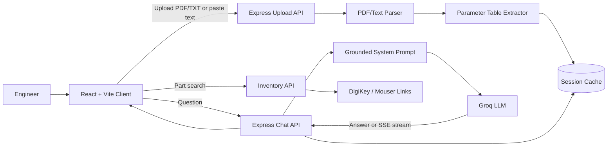
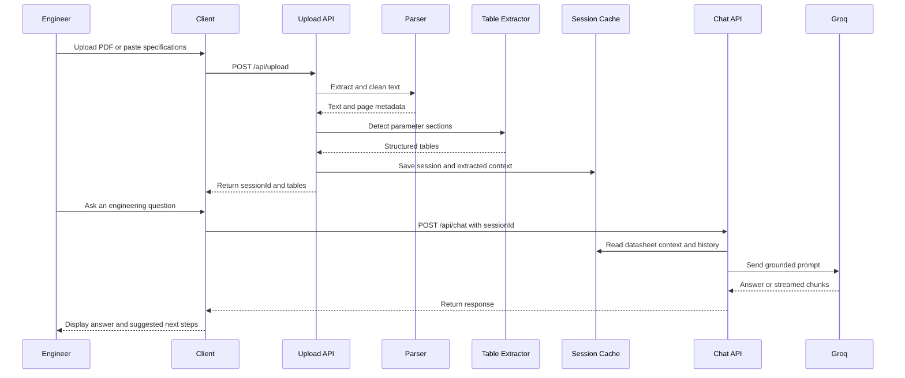

# DatasheetIQ

DatasheetIQ is an AI-powered hardware architecture assistant for reading component datasheets and answering practical electronics questions. Upload a datasheet or paste specifications, inspect extracted parameters, and ask questions about pinouts, operating conditions, electrical characteristics, and absolute maximum ratings.

The application is split into:

- **Client** — React 19 and Vite interface for uploading datasheets, viewing extracted tables, and chatting with the assistant.
- **Server** — Express API that parses input, extracts common datasheet sections, stores temporary sessions, and sends grounded prompts to Groq.

## Current capabilities

- Upload text-based PDF and TXT datasheets.
- Paste raw datasheet text directly into the interface.
- Detect and extract common sections:
  - Absolute Maximum Ratings
  - Electrical Characteristics
  - Recommended Operating Conditions
  - Pin Configuration
- Show extracted parameters in a dedicated panel.
- Ask follow-up questions using the uploaded datasheet as context.
- Stream assistant responses over Server-Sent Events.
- Preserve a short chat history for each processing session.
- Warn when extracted text suggests a scanned or image-based PDF.
- Start with sample datasheet excerpts for ESP32, ICE2PCS01, and ATmega328P.
- Provide manual DigiKey and Mouser search links through the inventory endpoint.

## Product status

DatasheetIQ is currently a functional prototype. It is suitable for exploration and engineering assistance, but it should not replace the original manufacturer datasheet, formal design review, or laboratory validation. AI-generated answers must be checked against the component vendor's latest documentation.

Some UI copy currently mentions OCR support, but image-based OCR is not yet wired into the upload flow. Scanned PDFs may therefore return incomplete text.

## Project structure

```text
Datasheet_ML/
├── client/
│   ├── src/
│   │   ├── components/       # Application UI and reusable visual components
│   │   ├── hooks/            # Upload and chat state
│   │   ├── services/api.js   # Browser-to-server API client
│   │   └── App.jsx
│   └── package.json
├── server/
│   ├── src/
│   │   ├── middleware/       # Upload and error handling
│   │   ├── prompts/          # Datasheet-grounded system prompt
│   │   ├── routes/           # Upload, chat, and inventory endpoints
│   │   └── services/         # PDF parsing, table extraction, and Groq client
│   ├── uploads/              # Runtime uploads and session cache
│   └── package.json
└── README.md
```

## System architecture



## Datasheet analysis flow



The diagrams use GitHub-compatible Mermaid syntax and may also be rendered by documentation tools that support Mermaid fenced code blocks.

## Requirements

- Node.js 18 or newer
- npm
- A Groq API key for AI chat responses

## Local setup

### 1. Install dependencies

```bash
cd server
npm install

cd ../client
npm install
```

### 2. Configure the server

Create `server/.env`:

```env
GROQ_API_KEY=your_groq_api_key
PORT=3001
```

`PORT` is optional and defaults to `3001`. Do not commit `.env` files or API keys.

### 3. Start the server

```bash
cd server
npm run dev
```

The API will be available at `http://localhost:3001`. Verify it with:

```text
http://localhost:3001/api/health
```

### 4. Start the client

In a second terminal:

```bash
cd client
npm run dev
```

Open the Vite URL shown in the terminal, normally `http://localhost:5173`.

The browser API client currently targets `http://localhost:3001/api`. Update `client/src/services/api.js` or add an environment-based API URL before deploying to another environment.

## API reference

| Method | Endpoint | Purpose |
|---|---|---|
| `GET` | `/api/health` | Check server and Groq configuration status |
| `POST` | `/api/upload` | Upload one PDF or TXT file |
| `POST` | `/api/upload/text` | Create a session from pasted text |
| `POST` | `/api/chat` | Ask a question about a session |
| `GET` | `/api/chat/history/:sessionId` | Read a session's chat history |
| `POST` | `/api/inventory/search` | Return component search links; provider lookup is not implemented yet |

### Chat request

```json
{
  "sessionId": "session-id-from-upload",
  "message": "What is the maximum GPIO current?",
  "stream": false
}
```

Set `stream` to `true` to receive `text/event-stream` response chunks.

## Development commands

### Client

```bash
npm run dev       # Start Vite development server
npm run build     # Create a production build
npm run lint      # Run Oxlint
npm run preview   # Preview the production build
```

### Server

```bash
npm run dev       # Start Express with Node watch mode
npm start         # Start Express normally
```

There is currently no automated server test suite. New API behavior should be covered with route and service tests as part of the roadmap below.

## Changes to be made

The following changes are recommended to move the prototype toward a dependable production tool.

### Priority 1 — reliability and safety

- Add automated tests for PDF parsing, table extraction, upload validation, chat requests, and streaming responses.
- Replace in-memory session storage and `uploads/.sessions.json` with a durable database and an explicit session expiration policy.
- Add cleanup for uploaded files and expired sessions.
- Validate and sanitize request bodies, filenames, session IDs, and chat message lengths.
- Configure CORS from an allowlist instead of accepting every origin.
- Add authentication, rate limiting, request IDs, and structured server logging.
- Add a clear source-reference mode so answers can cite page numbers or text locations.
- Add an explicit disclaimer in the chat UI for safety-critical design decisions.

### Priority 2 — extraction quality

- Implement the planned OCR path for scanned PDFs and image uploads using the existing OCR dependency or a dedicated worker.
- Preserve page boundaries and source coordinates during PDF extraction.
- Replace heuristic table parsing with a parser that handles merged cells, units, min/typ/max columns, footnotes, and multi-page tables.
- Add confidence scores and an extraction review state for ambiguous values.
- Normalize units and distinguish absolute maximum ratings from recommended operating conditions.
- Add support for multiple datasheets in one workspace and cross-reference compatible components.

### Priority 3 — product functionality

- Implement real inventory and pricing integrations for DigiKey, Mouser, and/or Octopart.
- Add export to Markdown, CSV, and a design-review report.
- Add saved projects, searchable history, and shareable read-only sessions.
- Add configurable model, temperature, token, and context settings.
- Add citations, answer regeneration, feedback capture, and prompt/version tracking.
- Add a deployment configuration with environment-based client API URLs.

## Future projections

### Near term: 1–2 releases

- Stable upload and chat flows with route-level test coverage.
- OCR-backed scanned datasheet processing.
- Page-aware citations and a clearer extraction confidence indicator.
- Session cleanup and persistent storage.
- Improved error messages for missing API keys, malformed PDFs, and unavailable model responses.

### Medium term: 3–5 releases

- Multi-document workspaces with comparison views.
- Interactive pinout and electrical-parameter visualizations.
- Automatic checks for voltage-level mismatches, current-limit violations, missing pull-ups, decoupling requirements, thermal constraints, and power-budget issues.
- Inventory availability, pricing, lifecycle status, and approved-alternative suggestions.
- Exportable engineering review reports with traceable evidence.

### Long term: platform direction

- A retrieval-augmented knowledge base containing vendor documents, application notes, errata, and design guidelines.
- Connector and schematic import for checking a proposed circuit against datasheet constraints.
- A rules engine that separates deterministic electrical checks from probabilistic AI explanations.
- Team workspaces with roles, audit trails, review comments, and organization-wide component libraries.
- Optional private or self-hosted inference for confidential hardware designs.
- Integrations with EDA tools and component-management systems.

## Safety and responsible use

DatasheetIQ can help identify likely constraints, but it cannot certify a circuit. Always confirm values in the manufacturer's original document, account for tolerances and operating conditions, and validate hardware with appropriate measurements and protection before production use.

## Contributing

When contributing:

1. Keep parsing and safety checks deterministic where possible.
2. Preserve source context for every extracted value.
3. Add tests for changed API or extraction behavior.
4. Avoid placing credentials, private datasheets, or generated uploads in git.
5. Update this README when setup steps, endpoints, or supported formats change.
